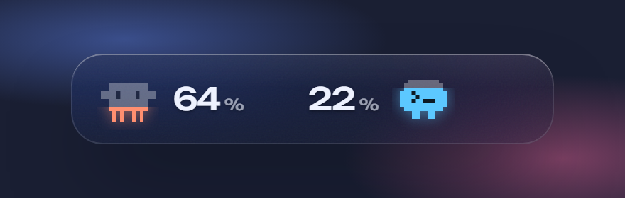

# Agent Gauge

Un widget de escritorio, siempre visible y de cristal esmerilado, para quien trabaja con **Claude Code** y **Codex** a la vez. Te dice de un vistazo cuánto te queda en cada cuenta y qué agentes están trabajando ahora mismo, en tu ordenador, en tus servidores por SSH y en la nube.

<p align="center">
  
</p>

<p align="center">
  
</p>

## Qué te enseña

- **Cuánto has gastado** de la sesión de 5 horas de Claude Code y de Codex, cuándo se renueva y, al pasar el ratón, el límite semanal, los tokens y el ritmo que llevas. Si a este ritmo vas a llegar al límite antes de la renovación, el arco se pone rojo y te dice cuándo.
- **Tus proyectos activos**, cada uno con su "jefe" (el chat de Claude que manda) y su "cuadrilla" (los Codex y subagentes que ha lanzado). Mientras trabajan, el jefe da latigazos de dibujos animados y la cuadrilla suda. Al pasar el ratón ves quién es quién.
- **Dónde corre cada cosa**, con pestañas: este PC, cada servidor al que entras por SSH y la nube de Claude (sesiones sobre tus repositorios de GitHub).
- **Agentes dormidos**: lo que trabajó en las últimas 24 horas sigue saliendo, con los ojos cerrados, para que sepas qué tienes abierto.
- **Lo saturado que está cada chat**: una barrita con el % de contexto usado, que se pone roja cuando toca empezar uno nuevo.
- **Modo compacto**: con el botón ⌃ el widget se queda en una píldora. Cada bichito está vaciado y se rellena de abajo arriba con lo que te queda.

## Instalar

### Opción A: descargar el instalador

En la página de **Releases** del repositorio, descarga el archivo de tu sistema:

| Sistema | Archivo |
|---|---|
| Windows | `Agent.Gauge_*_x64-setup.exe` |
| macOS con Apple Silicon | `Agent.Gauge_*_aarch64.dmg` |
| macOS con Intel | `Agent.Gauge_*_x64.dmg` |
| Linux | `.AppImage` o `.deb` |

La app no está firmada, así que la primera vez el sistema avisa:

- **Windows:** en la ventana azul de SmartScreen, pulsa **Más información** y luego **Ejecutar de todas formas**.
- **macOS:** haz clic derecho sobre la app y elige **Abrir**.

### Opción B: compilar desde el código

Descarga el repositorio y ejecuta el script de tu sistema. Si te falta algo, el script te dice exactamente qué instalar.

**Windows** (PowerShell, desde la carpeta del repositorio):

```powershell
./scripts/install.ps1
```

Necesitas Node 20+, Rust y las herramientas de C++ de Visual Studio. Si no los tienes:

```powershell
winget install OpenJS.NodeJS.LTS
```

```powershell
winget install Rustlang.Rustup
```

```powershell
winget install Microsoft.VisualStudio.2022.BuildTools --override "--passive --wait --add Microsoft.VisualStudio.Workload.VCTools --includeRecommended"
```

Después abre una terminal nueva y vuelve a ejecutar el script.

**macOS o Linux:**

```bash
./scripts/install.sh
```

Necesitas Node 20+ y Rust (`curl https://sh.rustup.rs -sSf | sh`). En Debian/Ubuntu, además: `sudo apt install libwebkit2gtk-4.1-dev libayatana-appindicator3-dev librsvg2-dev build-essential`.

## Usarlo

- **Abrirlo:** desde el menú Inicio, el acceso directo del escritorio (Windows) o Aplicaciones (macOS). Aparece arriba a la derecha.
- **Moverlo:** arrástralo desde la franja de arriba.
- **El icono de la bandeja** (junto al reloj; en Windows puede estar dentro de la flecha ^):
  - clic izquierdo: muestra u oculta el widget;
  - clic derecho: **Mostrar u ocultar**, **Abrir al iniciar sesión** y **Salir**.
- La **✕** del widget solo lo oculta. Para cerrarlo del todo, usa **Salir**.
- Para que arranque solo al encender el ordenador, marca **Abrir al iniciar sesión** en ese menú.
- Cuando no lo estás usando se queda translúcido. Al hacer clic dentro se vuelve más opaco para leerlo mejor.

## Qué necesita de tus cuentas

El widget no usa claves de API: aprovecha los inicios de sesión que ya tienes.

| Para ver… | Necesitas |
|---|---|
| El uso de Claude Code y tus sesiones en la nube | Haber iniciado sesión en Claude Code (con el comando `claude` o desde la app de escritorio de Claude) |
| El uso de Codex | Haber iniciado sesión en Codex (`codex login`) |
| Los Codex de un servidor SSH | Que ese servidor acepte tu clave SSH sin contraseña (ver abajo) |

**Servidores por SSH.** Cuando trabajas con Claude sobre un servidor por SSH, el widget le pregunta qué Codex tiene en marcha. Solo puede entrar con tu clave, nunca con contraseña. Si el servidor todavía no la acepta, autorízala una vez (te pedirá la contraseña del servidor):

```powershell
type $env:USERPROFILE\.ssh\id_ed25519.pub | ssh usuario@servidor "mkdir -p ~/.ssh && cat >> ~/.ssh/authorized_keys"
```

## Privacidad: qué lee y a dónde lo envía

Todo se procesa en tu ordenador. De tus conversaciones solo se leen metadatos (título, carpeta, tokens, horas), nunca el texto.

| Dato | De dónde sale | Se envía a |
|---|---|---|
| Uso de Claude Code | El mismo servicio que `/usage`, con tu login de Claude Code | Anthropic |
| Sesiones de Claude en la nube | El mismo servicio con el que Claude Code lista tus sesiones web | Anthropic |
| Uso de Codex | El mismo servicio que `/status`, con el login de `~/.codex/auth.json` | OpenAI |
| Chats y subagentes locales | `~/.claude/projects` y `~/.codex/sessions` | Nadie |
| Codex en servidores SSH | Un script de solo lectura que se ejecuta por SSH en tu servidor | Tu servidor |

- El login de Codex solo se lee; nunca se renueva ni se modifica.
- El de Claude se renueva cuando caduca, igual que hace Claude Code, y se guarda sin tocar el resto del archivo. En macOS, el acceso al Llavero es de solo lectura.
- Las carpetas se pueden cambiar con las variables `CLAUDE_CONFIG_DIR` y `CODEX_HOME`.

Los servicios de uso de Anthropic y OpenAI no son públicos y podrían cambiar. Si alguno falla, el widget lo dice y sigue mostrando lo demás.

## Si algo no sale

| Ves… | Qué pasa y qué hacer |
|---|---|
| "Anthropic limita las consultas ahora mismo" | Anthropic ha frenado las consultas de uso. El widget espera solo (de 2 a 15 minutos) y vuelve a mostrar el % en cuanto puede. No abras dos copias del widget a la vez. |
| "La sesión de Claude caducó del todo" | Abre Claude Code y vuelve a iniciar sesión. |
| El % de Codex no cambia | Comprueba que has iniciado sesión con `codex login`. |
| No aparece tu servidor SSH | Autoriza tu clave en el servidor (ver arriba). Solo salen servidores con un chat de las últimas 24 horas. |
| Un proyecto no aparece | Solo se muestran los que han tenido actividad en las últimas 24 horas. En la pestaña "Todos" salen 4 como mucho: el resto está en su pestaña. |

## Desarrollo

```bash
npm install
```

```bash
npm run dev        # solo la interfaz en el navegador, con datos de ejemplo
```

```bash
npm run app:dev    # la app de escritorio completa
```

En el navegador puedes ver otros estados añadiendo a `http://localhost:1420/`: `?demo=hot` (Claude cerca del límite), `?demo=empty` (sin datos) o `?compact=1` (modo compacto).

Tests y lint del backend:

```bash
cd src-tauri && cargo test && cargo clippy --all-targets -- -D warnings
```

Para publicar instaladores de todos los sistemas, sube una etiqueta. El workflow `.github/workflows/release.yml` los compila y los deja en un borrador de Release:

```bash
git tag v0.2.0
```

```bash
git push origin v0.2.0
```

### Estructura

```
src/                    interfaz (TypeScript + CSS, sin framework)
  main.ts               render, pestañas, modo compacto y lectura cada 20 s
  critters.ts           los bichitos en pixel art y el látigo
  gauge.ts              el arco de cada cuenta
  format.ts             tiempos, tokens y proyección de ritmo
  mock.ts               datos de ejemplo para el navegador
src-tauri/src/
  lib.rs                ventana, cristal, bandeja, autoarranque
  claude.rs             uso de Claude Code y renovación del login
  codex.rs              uso de Codex a partir de sus registros
  codex_live.rs         uso de Codex en directo (como /status)
  cloud_claude.rs       sesiones de Claude en la nube, por repositorio
  chats_claude.rs       chats y subagentes locales de Claude
  chats_codex.rs        chats y subagentes locales de Codex
  chats_remote.rs       Codex en servidores SSH (+ remote_codex.sh)
  chats.rs              agrupación por entorno y proyecto (jefe y cuadrilla)
  model.rs              tipos compartidos (espejo de src/types.ts)
docs/superpowers/       diseño y plan de implementación
```
