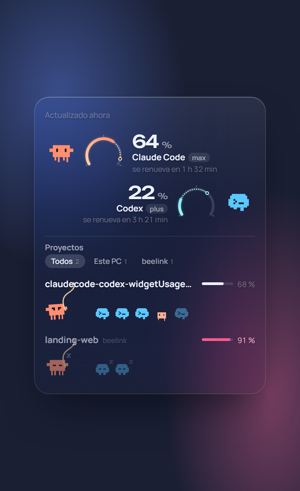

# Agent Gauge

Un widget de escritorio de cristal ahumado, siempre visible, que muestra cuánto te queda en **Claude Code** y en **Codex**, y qué sesiones de ambos están corriendo ahora mismo en tu ordenador.




## Qué enseña

- **Un medidor por cuenta.** Muestra el % usado de la sesión de 5 horas, cuándo se renueva y el % del límite semanal.
- **Proyección de ritmo.** La línea punteada sobre el arco marca dónde acabarás al renovarse la sesión si sigues al ritmo actual. Si vas camino de pasarte, el arco se vuelve rojo y te dice en cuánto tiempo llegarás al límite.
- **Tokens de las últimas 5 horas**, contados a partir de los registros locales.
- **Sesiones en marcha.** Cada `claude` o `codex` abierto aparece con su carpeta, su CPU y cuánto tiempo lleva. El punto late cuando la sesión está trabajando.
- **Modo compacto.** El botón ⌃ (visible al pasar el ratón) reduce el widget a una píldora con los dos porcentajes.

El widget se arrastra desde la parte superior. Se oculta con ✕ y vuelve con el icono de la barra de menús o de la bandeja, donde también puedes activar **Abrir al iniciar sesión**.

## Instalar

### Opción A: descargar el instalador (la más fácil)

Ve a **Releases** y descarga el que corresponda a tu sistema:

| Sistema | Archivo |
|---|---|
| macOS con Apple Silicon | `Agent.Gauge_*_aarch64.dmg` |
| macOS con Intel | `Agent.Gauge_*_x64.dmg` |
| Windows | `Agent.Gauge_*_x64-setup.exe` |
| Linux | `.AppImage` o `.deb` |

Los instaladores los genera el workflow `.github/workflows/release.yml` al subir una etiqueta:

```bash
git tag v0.1.0
```

```bash
git push origin v0.1.0
```

> En macOS la app no está firmada. La primera vez, haz clic derecho sobre ella y elige **Abrir**.

### Opción B: compilar desde el código

Necesitas Node 20+ y Rust.

macOS o Linux:

```bash
./scripts/install.sh
```

Windows (PowerShell):

```powershell
./scripts/install.ps1
```

## De dónde salen los datos

Los registros se procesan en local. El widget usa tu sesión de Claude Code para consultar los límites de Anthropic y funciona sin claves de API.

| Dato | Fuente |
|---|---|
| Límites de Codex | `~/.codex/sessions/**/rollout-*.jsonl`: el último evento `token_count` trae `rate_limits` |
| Límites de Claude Code | El mismo endpoint que usa `/usage` en Claude Code, con el login que ya tienes (Llavero en macOS, `~/.claude/.credentials.json` en Linux y Windows). Las consultas se guardan en caché durante un minuto. |
| Tokens de Claude Code | `~/.claude/projects/**/*.jsonl` |
| Chats activos | Metadatos de los registros de Claude Code y Codex con actividad en los últimos 10 minutos |

El endpoint de límites de Claude es privado y podría cambiar. Si falla, el widget lo indica y sigue mostrando los tokens locales. En Windows y Linux, el widget puede renovar el token con Anthropic y guardar los campos renovados de forma atómica, conservando el resto del archivo de credenciales. Si falla la renovación, te pide abrir Claude Code y volver a iniciar sesión. En macOS, el acceso al Llavero es de solo lectura y el widget te pide abrir `claude` cuando caduca la sesión.

Puedes cambiar las carpetas con las variables `CLAUDE_CONFIG_DIR` y `CODEX_HOME`.

## Desarrollo

```bash
npm install
```

```bash
npm run dev          # solo la interfaz en el navegador, con datos de ejemplo
```

```bash
npm run app:dev      # la app de escritorio completa
```

Para ver otros estados en el navegador, añade `?demo=hot` (Claude cerca del límite) o `?demo=empty` (sin datos) a `http://localhost:1420/`.

Tests del backend:

```bash
cd src-tauri && cargo test
```

Estructura:

```
src/                 interfaz (TypeScript + CSS, sin framework)
  main.ts            render y polling (cada 20 s)
  gauge.ts           el medidor SVG
  format.ts          tiempos, tokens y proyección de ritmo
  mock.ts            datos de ejemplo para el navegador
src-tauri/src/
  lib.rs             ventana, cristal nativo, bandeja, autoarranque
  claude.rs          límites y tokens de Claude Code
  codex.rs           límites y tokens de Codex
  chats.rs           selección de chats activos de Claude y Codex
  model.rs           tipos compartidos (espejo de src/types.ts)
```
